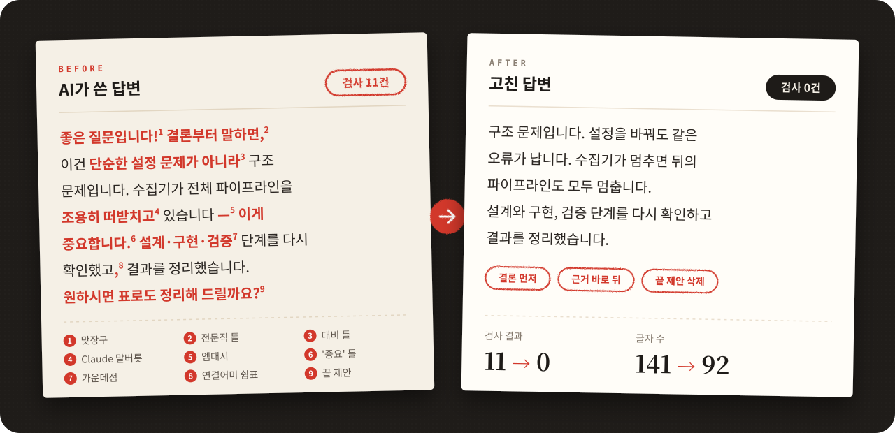

<p align="center">
  
</p>

<p align="center">
  
  
  
  
</p>

<br>

`좋은 질문입니다!`로 시작해서 `원하시면 표로도 정리해 드릴까요?`로 끝나는 답변을 한 번쯤 받아 보셨을 겁니다. 이 스킬은 그런 말투를 찾아서 사람이 쓴 문장으로 고칩니다.

보고서, 업무 메일, 고객 메신저 회신, 화면 문구, 탐지 룰 설명, 블로그 글을 다룹니다. Claude Code와 Codex에서 스킬로 씁니다. 검사 스크립트만 따로 돌려도 됩니다.

## 한눈에 보기

<p align="center">
  
</p>

왼쪽 답변을 검사 스크립트에 넣으면 11건이 걸립니다. 오른쪽처럼 고치면 0건입니다. 결론을 첫 문장에 두고 근거를 바로 뒤에 붙였더니 글자 수도 141자에서 92자로 줄었습니다.

## 잡아내는 말투

| 계열 | 이런 글이 걸립니다 | 이렇게 고칩니다 |
| :--- | :--- | :--- |
| 문장부호와 서식 | `설계·구현·검증`, `—`, `**항목**: 설명`, 이모지 목록, 숨은 문자 | `설계와 구현, 검증` |
| 2026년 구조 신호 | `단순한 설정 문제가 아니라 구조 문제입니다`, `~로 기능합니다` | `구조 문제입니다. 설정을 바꿔도 같은 오류가 납니다.` |
| 모델별 말버릇 | `조용히 삼켜집니다`, `두 축으로`, `중요한 건`, `결론부터 말하면` | `기록되지 않고 사라집니다`, `두 가지 기준으로` |
| 상투어와 번역투 | `다양한`, `체계적인`, `~를 통해`, `되어진다`, 문장 첫머리의 `이는` | 실제 개수와 항목, 능동문 |
| 프롬프트 부작용 | `~라는 뜻은 아니다`, `좋은 질문입니다`, `원하시면 ~해 드릴까요?` | 지웁니다 |
| 2026년 하반기 신호 | `이게 중요합니다`, `단순한 도구 그 이상`, `원인은? 설정 누락이었다.` | `이 값이 틀리면 알림이 가지 않습니다.` |
| 매체별 어색한 문구 | `스스럼없이 말씀해 주세요`, `유효성 검증에 실패하였습니다` | `편하게 말씀해 주세요`, `날짜 형식을 다시 확인해 주세요` |

오래된 신호도 빼지 않습니다. 엠대시처럼 요즘 덜 보이는 버릇도 계속 잡습니다. 새로 생긴 버릇은 그 위에 더합니다.

## 검사 스크립트

<p align="center">
  
</p>

파이썬 표준 라이브러리만 씁니다. 따로 설치할 패키지는 없습니다.

```bash
python scripts/lint_korean_slop.py 보고서.md
python scripts/lint_korean_slop.py 답변.txt --medium chat
python scripts/lint_korean_slop.py 화면문구.tsx --medium ui --json
```

Windows에서는 `python` 대신 `py -I`를 씁니다.

| 옵션 | 쓰는 곳 | 끄는 검사 |
| :--- | :--- | :--- |
| `--medium report` (기본) | 보고서, 설계 문서 | 없음 |
| `--medium chat` | 대화 답변, 메신저 | 짧은 문장 연속 |
| `--medium ui` | 화면 문구 | 문장 길이 관련 검사 |
| `--json` | 다른 도구와 연결할 때 | 출력만 JSON으로 바꿈 |

검사 결과는 고칠 곳을 가리키는 힌트입니다. 사람이 쓴 글에서도 걸릴 수 있습니다.

## 설치

저장소를 스킬 폴더에 바로 받습니다.

```bash
# Claude Code
git clone https://github.com/Dradradre/korean-anti-slop-writing.git ~/.claude/skills/korean-anti-slop-writing

# Codex
git clone https://github.com/Dradradre/korean-anti-slop-writing.git ~/.agents/skills/korean-anti-slop-writing
```

Windows PowerShell에서는 `~` 대신 `$env:USERPROFILE`을 씁니다.

두 도구를 다 쓴다면 Codex 폴더에만 받고 Claude 폴더에는 연결만 걸어 둡니다. 그러면 한 곳만 고쳐도 두 도구에 반영됩니다.

```powershell
# Windows
New-Item -ItemType Junction -Path "$env:USERPROFILE\.claude\skills\korean-anti-slop-writing" -Target "$env:USERPROFILE\.agents\skills\korean-anti-slop-writing"
```

```bash
# macOS, Linux
ln -s ~/.agents/skills/korean-anti-slop-writing ~/.claude/skills/korean-anti-slop-writing
```

설치한 뒤에는 새 세션을 엽니다.

## 사용법

`이 글 윤문해 줘`, `AI 티 빼 줘`, `AI 말투 검사해 줘`처럼 말하면 스킬이 동작합니다. 스킬은 아래 순서로 일합니다.

1. 대상이 파일이면 검사 스크립트를 먼저 돌립니다.
2. 윤문 규칙 21개로 문장을 고칩니다.
3. 글 종류별 규칙을 적용하고 58개 항목 점검표로 다시 확인합니다.
4. 고친 파일을 한 번 더 검사합니다.

숫자, 날짜, 이름, 인용, IP, 필드명, 코드는 건드리지 않습니다. 이미 자연스러운 문장도 그대로 둡니다.

## 글 종류별 문장 끝

| 글 종류 | 문장 끝 | 예 |
| :--- | :--- | :--- |
| Word 보고서 | 명사형 (`~함`, `~됨`, `~있음`) | `이에 따라 해당 IP를 차단함.` |
| 설계 문서, 기술 명세 | `~한다` | `수집기는 매분 로그를 받아 파서로 넘긴다.` |
| 고객 메신저 회신 | `~습니다` | `정상 서비스 요청입니다.` |
| 메일, 블로그, 화면 문구 | 팀이 쓰는 대로 `~합니다` 또는 `~해요` | `작업을 취소했어요.` |
| 탐지 룰 설명 | `~하여 탐지` (마침표 없음) | `평소 접속하지 않던 해외 IP에서 관리자 계정으로 로그인하여 탐지` |

## 폴더 구성

```text
korean-anti-slop-writing/
├── SKILL.md                            스킬 본문과 윤문 규칙 21개
├── references/
│   ├── slop-patterns-and-fixes.md      고치기 전후 예문 사전
│   └── korean-editing-checklist.md     최종 점검표 58개 항목
├── scripts/
│   └── lint_korean_slop.py             검사 스크립트 (규칙 66개)
└── assets/                             README 이미지
```

## 이번 판에서 바뀐 점

<details>
<summary>v2 변경 내역 펼치기</summary>

- 2026년에 새로 드러난 AI 말투를 넣었습니다. `A가 아니라 B` 대비 틀, `~로 기능합니다` 같은 꾸민 동사, Claude와 GPT 말버릇, 맞장구와 끝 제안, 출처에 기댄 판단, 고른 문장 길이, 숨은 문자가 들어갑니다.
- 예전 신호(엠대시, 가운데점, 상투어)는 하나도 빼지 않았습니다.
- 가운데점은 고정 복합어까지 0건으로 바꿨습니다.
- 글 종류별 규칙을 넣었습니다. Word 보고서, 고객 메신저, 운영 화면, 룰 설명, 변경 이력이 들어갑니다.
- 짧은 문장 규칙은 보고서에만 적용합니다. 쉬운 말과 실무 어휘는 글 종류에 따라 고르게 했습니다.
- 칼럼과 기사 제목을 `~컸다`, `~개선됐다`처럼 `~다`로 끝내는 버릇을 넣었습니다. 명사형이나 신문식 제목으로 고칩니다.
- 2026년 하반기 신호를 넣었습니다. Claude Opus 5.5의 `이게 중요합니다`, `단순한 A 그 이상`, GPT의 `~를 입증하지는 않는다`, 혼자 묻고 답하기, 개수부터 말하기, 지어낸 개념 이름, 흐린 출처, 선생님 말투, 연결어미 뒤 쉼표, 채우지 않은 빈칸과 AI 도구 흔적이 들어갑니다.
- 검사 스크립트에 새 규칙 56개를 더했습니다. 한자, 숨은 문자, 이모지, 반말 섞임, 문장형 제목, 연결어미 뒤 쉼표도 잡습니다.

</details>

## 참고한 자료

- Graphite의 `AI Tells` 연구. Claude Opus 5.5와 GPT Astra의 글을 ChatGPT 이전에 사람이 쓴 기사 1만 편과 비교했습니다. (2026년 10월)
- The Economist의 분석. ChatGPT, Claude, Gemini, Grok이 쓴 글 120만 단어를 살폈습니다. (2026)
- GitHub PR 설명 46만 7천 건에서 Claude가 자주 쓰는 어휘를 뽑은 분석 (2026)
- tropes.fyi의 AI 글쓰기 버릇 목록, Wikipedia의 `Signs of AI writing` 문서 (2026)
- KAIST XDAC의 AI 댓글 연구
- 연결어미 뒤 쉼표를 다룬 국내 커뮤니티 글, `LLM 말투`와 `클로드 말투`를 다룬 국내 기사와 실무자 글 (2026)

<br>

<p align="center">
  <sub>이 README도 검사 스크립트로 검사했습니다. 결과는 0건입니다.</sub>
</p>
